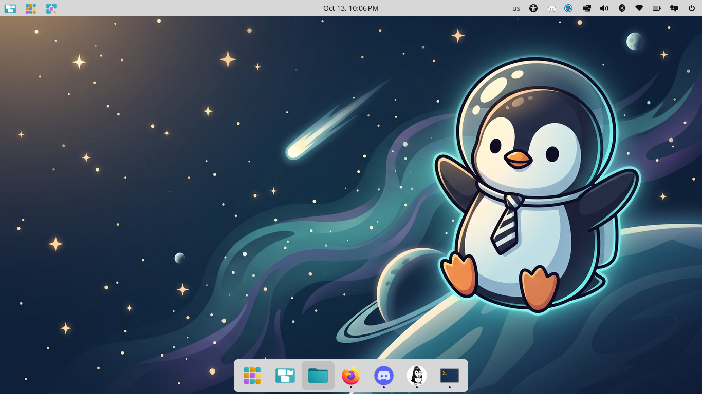

# PengyOS

A Linux distribution built from source with [Buildroot](https://buildroot.org), in
three editions that nest: Core inside Server inside Desktop. It runs on ordinary
modern PC hardware: laptops, desktops and mini PCs that boot in UEFI mode. The
newest install images are on the [download page](https://pengyos.catbee.ca/download/).

Free and MIT-licensed. It's also a side project rather than a product: no roadmap,
no target market. What it's trying to show is narrower than "another distro": that a
small human–AI team can build an operating system and keep it maintained.



## What you get

| Edition | What's on it |
|---|---|
| Core | The base: systemd, key-only SSH, Python 3, nftables, chrony, storage tools, a broad firmware set. Core utilities in Rust (uutils), and the text/search tools from their own projects — find, grep, sed, gawk, diff, patch, xargs, time, unzip, tar, tree, lsof, less — not BusyBox's cut-down applets. No editors, no containers, no GUI. About 224 MB of RAM at idle. |
| Server | Core plus tmux, mosh, zsh (with the comfort profile: starship prompt, fzf, zoxide, autosuggestions + syntax highlighting), git, ripgrep, fd, bat, eza and jq; rootless podman; distrobox; a default-deny firewall; a metrics timer and an opt-in backup timer; the daily update check; and Pengy in a browser (`pengy-web`). |
| Desktop | Server plus the full COSMIC session (compositor, panel, launcher, files, terminal, editor, store) behind a login screen, PipeWire audio, Bluetooth codecs, CUPS printing, Wi-Fi, Xwayland and Vulkan, a boot splash, Flatpak from Flathub (Firefox lands on first boot), 21 wallpapers, the Pengy desktop app and the mdit Markdown editor. Its firewall opens ports above 1024 (LAN games, Steam Remote Play, LocalSend) like Fedora Workstation. |
| Server NVIDIA | Server plus CUDA, `nvidia-smi`, persistence mode, and GPUs inside podman containers through CDI. |
| Desktop NVIDIA | Desktop plus the NVIDIA driver and its Vulkan and GL userspace, for Turing and newer. |

### Will it run on your machine

Any 64-bit PC that starts in UEFI mode, which is roughly anything from the last ten
years. Intel and AMD graphics are in the base image. An NVIDIA card needs one of the
NVIDIA editions, and those need Turing or newer (GTX 16, RTX 20 and anything after),
which is where NVIDIA's open kernel modules stop. Wi-Fi from Intel, Realtek, MediaTek,
Qualcomm and Broadcom is covered by the firmware set Core ships. The desktop has been
built and used daily on laptops and mini PCs, so that's what it behaves best on.

## Trying it

<https://pengyos.catbee.ca/download/> has the install images and the whole runbook:
which stick, how to write it, how to boot it, what the installer asks. The short
version:

- Secure Boot off in the firmware settings. The images aren't signed for it yet.
- Desktop boots into a live session you can try before installing. Server shows its
  installer on screen. Core has no installer: it runs from the stick, and you write
  it to an internal disk the same way.
- Installing erases the whole target disk. 20 GB or more.
- Desktop is a 1.4 GB download that writes 4.8 GB to the stick.

After installing, the machine checks for updates daily. An update is written to a
second root slot and booted once on trial; if it doesn't reach multi-user, the next
boot returns to the old slot by itself. Core can't update in place yet.

## What's different

- **Nothing else is underneath it.** No distro's package manager, patch set or
  configuration. Buildroot builds every package from source against a pinned tree,
  and each component choice is justified in [`SPEC.md`](SPEC.md) along with the
  alternatives it beat.
- **Core and Server rebuild byte for byte on a second machine.** Verified at 26.10.3.
  The Desktop can't yet, because COSMIC is built on the build host instead of from a
  recipe. That's the current state, not a footnote.
- **Small.** Core idles at about 224 MB of RAM, ships no desktop and no telemetry,
  and needs no account or cloud service.
- **Maintenance is a loop, not a sprint.** Upstream releases and CVE feeds are
  watched nightly, triaged with a local model, batched into one build, boot-checked,
  and published to a testing channel. The tooling has no code path to the stable
  channel: a person signs the release key. The loop has published its own releases
  since 2026-10-05 (26.10.8).
- **The assistant ships in the image.** Server carries `pengy-web`, Desktop carries
  the Pengy app, and the same agent watches for updates and triages CVEs. Ignore it
  and the OS still runs; nothing about it is required.

## What isn't ready

- Server NVIDIA has only been booted under QEMU so far. Desktop NVIDIA has run on real
  hardware since 26.10.7: an RTX 3060 Ti with two 1440p monitors at 144 and 180 Hz,
  `nvidia-smi` working, COSMIC rendering on the GPU instead of the CPU. Its boot splash
  still blanks for a moment while the driver takes over.
- Secure Boot and measured boot aren't enforced, and the boot chain is unsigned.
  Someone with physical access or root can change what boots.
- There's no package manager in the familiar sense. The base system changes by
  writing a new signed image; apps come through Flatpak. `/etc`, services and your
  data live on a separate partition that updates never touch.
- x86_64 only. No ARM build.
- No screen reader yet. COSMIC's accessibility toggles are there, but Orca isn't in the
  image.
- Hardware support is driven by the handful of machines we run it on. Common Intel and
  AMD laptops and mini PCs are the safest bet; unusual Wi-Fi cards and HDMI audio
  paths are where trouble shows up, and one HDMI-audio case is worked end to end in
  [`docs/hdmi-audio-problems.md`](docs/hdmi-audio-problems.md).
- It's early. Expect rough edges.

## Building it instead

```sh
scripts/provision-build-host.sh      # Ubuntu 26.04, KVM, ~16 GB RAM, ~150 GB disk
cd tools/pengyos-build
python3 -m pengyos_build acquire pengyos-core --targets ../../targets.toml
python3 -m pengyos_build build     pengyos-core --targets ../../targets.toml
```

`tools/pengyos-qemu-verify` boots the result headless and asserts it reaches a
login prompt. The full recipe, including the COSMIC host build the Desktop needs, is
in [`CONTRIBUTING.md`](CONTRIBUTING.md).

## The repo

`tools/` holds 68 directories, each a tested project with its own spec and test
suite. `buildroot-external/` is our Buildroot tree: boards, defconfigs, authored
recipes. `scripts/` has the host helpers, `docs/` the design record, and
`.github/workflows/` runs the whole gate on every push.

## Reading on

- [`docs/principles.md`](docs/principles.md) — why the project is built this way:
  the principles, the maintenance loop, the rubric every component is scored
  against, and the failure modes we design against.
- [`SPEC.md`](SPEC.md) — the component stack, with the alternatives rejected.
- [`USE-CASES.md`](USE-CASES.md) — who it's for. The user stories whose acceptance
  criteria become our tests; when this file and SPEC disagree, this file wins.
- [`docs/`](docs/) — install/update architecture, the on-disk state layout, the
  QEMU runbook, the replacement ladder, our AI-contribution stance.
- [`SECURITY.md`](SECURITY.md) — reporting a vulnerability, and how an update is
  trusted.
- [`CHANGELOG.md`](CHANGELOG.md) — what has shipped.
- [`divergence.toml`](divergence.toml) — every fork and carried patch set, with the
  condition under which it goes away.

## Contributing

See [`CONTRIBUTING.md`](CONTRIBUTING.md). Point at a user story, prove the change
with a build or test someone else can reproduce, run
`python3 scripts/pengyos_gate.py run --repo . --mode full`, keep it small.
Contributions from people and from agents are both welcome and both disclosed.

## License

[MIT](LICENSE) © 2026 Pat Wendorf. Component licenses that differ, and the reasoning
for them, are recorded in [`SPEC.md`](SPEC.md).

"PengyOS" is a working name that collides with the Pengy assistant. Alternatives are
open.
